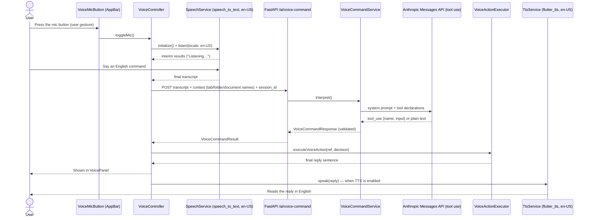
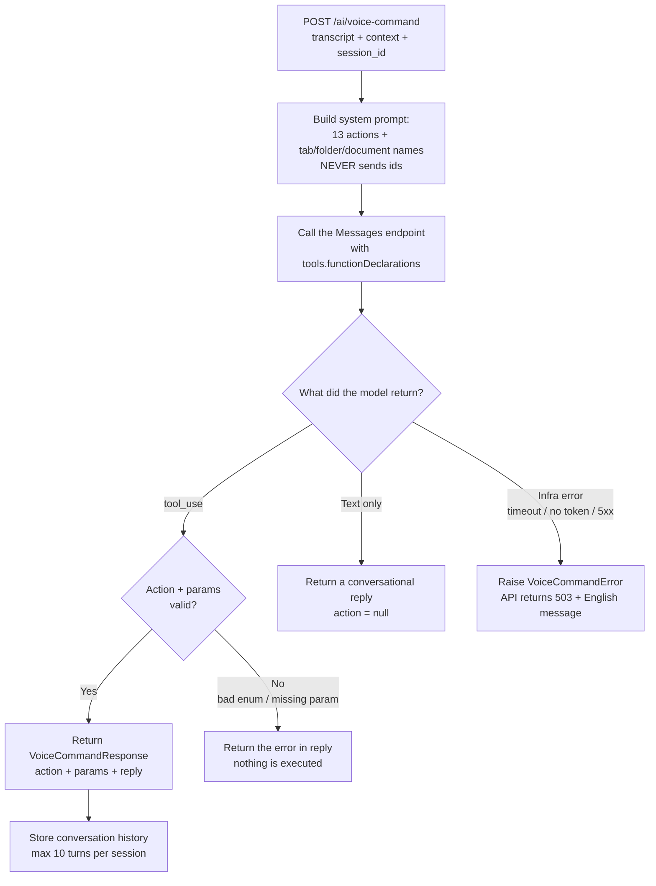
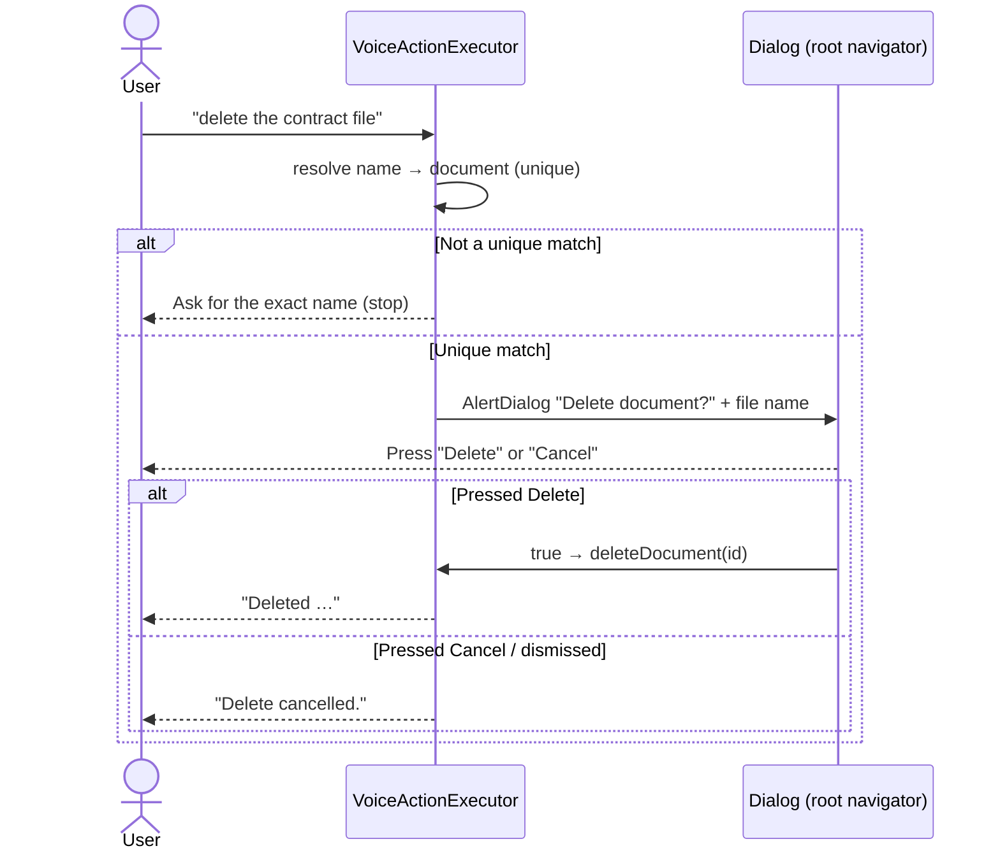
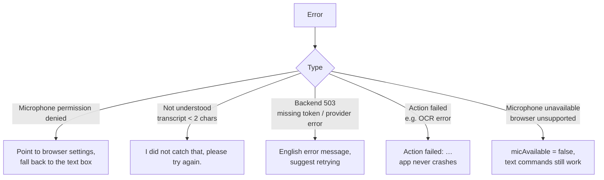

# English voice command flows

This document describes the implemented flows of the DocuVault voice assistant:
STT (Web Speech API, `en-US`) → LLM tool use → client-side action execution → TTS reply.
Everything the user hears or reads from the assistant is English.

## 1. End-to-end push-to-talk flow



## 2. Backend — LLM tool use



Key points:
- **13-action whitelist**: `navigate_tab`, `open_ai_tool`, `select_folder`, `list_documents`, `open_document`, `run_ocr`, `ask_chat`, `translate_text`, `read_aloud`, `stop_speaking`, `delete_document`, `merge_documents`, `split_document`.
- The model only sees folder/document **names** — never ids; name → id mapping happens on the client, so the AI cannot guess ids.
- Conversation history is kept in memory per `session_id` (max 10 turns) so follow-ups like "open the file I just mentioned" work.
- Provider config lives in `.env`: `ANTHROPIC_AUTH_TOKEN`, `ANTHROPIC_BASE_URL`, `ANTHROPIC_MODEL`.

## 3. Client — action execution and document name resolution

```mermaid
flowchart TD
    A[executeVoiceAction] --> B{Action}
    B -- navigate_tab / open_ai_tool --> C[Switch tab provider<br/>close the PDF viewer if open]
    B -- list_documents / select_folder --> D[Filter / read the list<br/>from DocumentsController]
    B -- open_document / run_ocr /<br/>ask_chat / translate_text --> E[Call the matching repository<br/>update AI state]
    B -- read_aloud / stop_speaking --> F[Read the latest result / stop TTS]
    B -- delete / merge / split --> G[Needs confirmation — see flow 4]
    B -- Unknown action --> H[Nothing executed,<br/>reply "not supported by voice"]
```

```mermaid
flowchart TD
    A[Document name parameter<br/>e.g. "contract"] --> B[name_matcher:<br/>strip Vietnamese diacritics, normalize]
    B --> C{Match result}
    C -- Unique --> D[Use that document]
    C -- Ambiguous<br/>several similar files --> E[Reply with the candidates,<br/>ask for the full name]
    C -- None --> F["No document named …" + similar names]
    E --> G[User repeats the command → flow restarts]
```

## 4. Destructive actions (delete / merge / split) — always confirmed



- **Merge**: resolves each name → if fewer than 2 PDFs, asks again; the dialog pre-fills the merged file name (the model may suggest `new_name`) → the user reviews or edits it.
- **Split**: the dialog pre-fills the page `ranges` from the model params → the user reviews before it runs.

## 5. Error flows



Every error is caught inside `VoiceController` / `executeVoiceAction` — the app never crashes because of a voice command.

## 6. Text-command fallback

When the mic is unavailable (permission denied, browser without Web Speech API) or the user prefers typing,
VoicePanel offers a text field: type `"go to the documents tab"`, `"run OCR on the contract file"`, …
Those commands go straight into `_process()` exactly like a mic transcript (the STT step is skipped).
