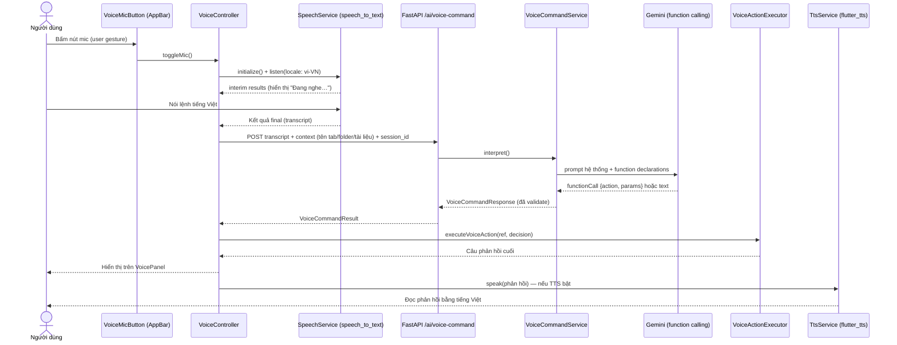
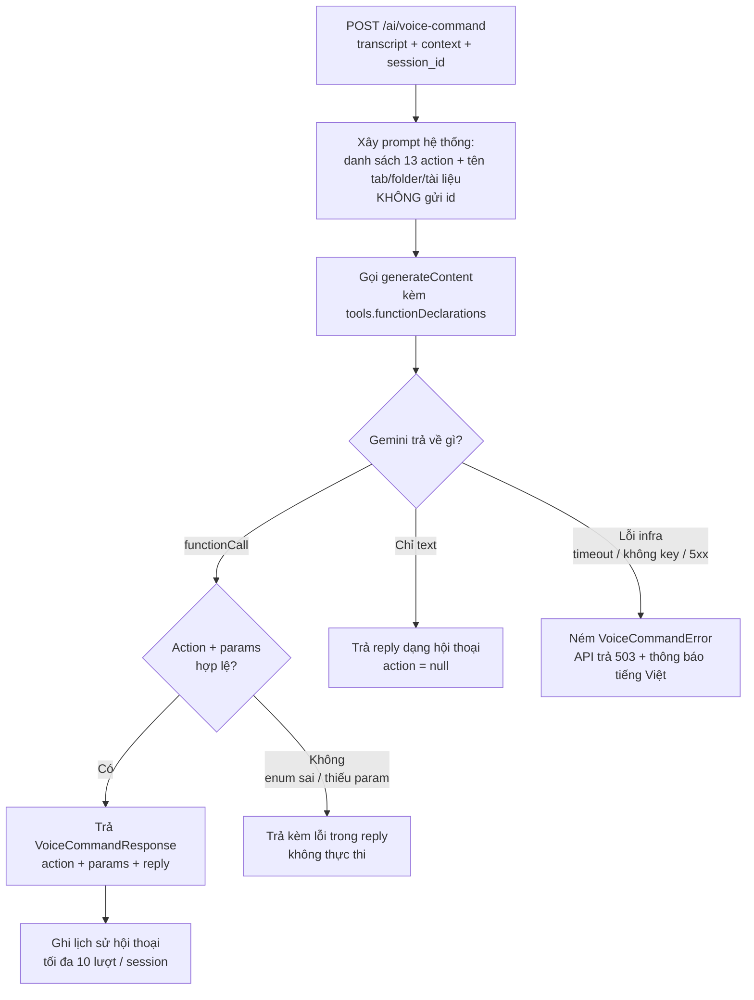
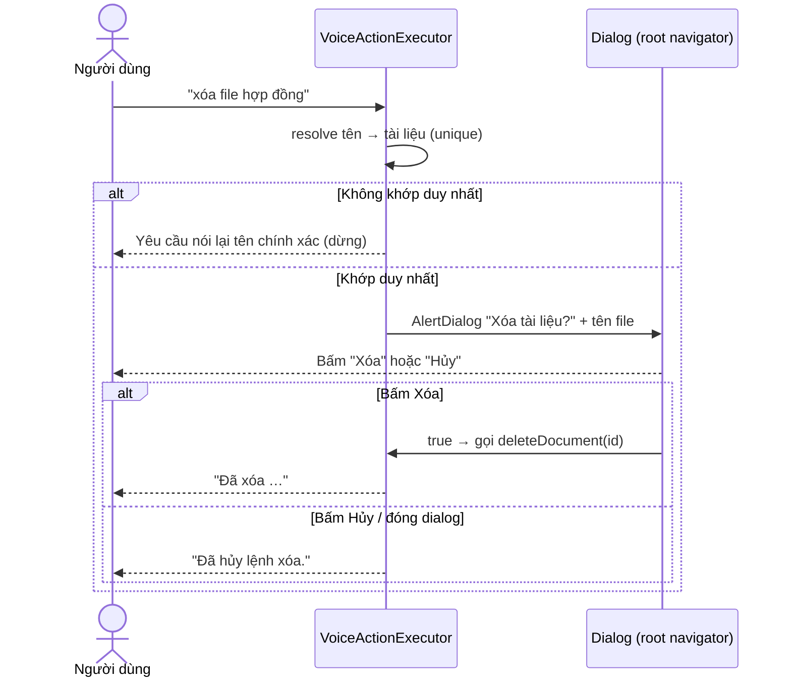
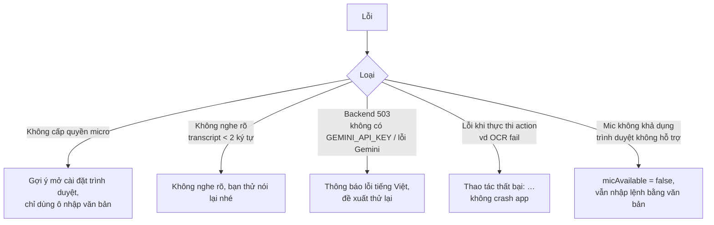

# Luồng chức năng ra lệnh bằng giọng nói tiếng Việt

Tài liệu mô tả các luồng đã triển khai của trợ lý giọng nói trong DocuVault:
STT (Web Speech API) → Gemini Function Calling → thực thi action trên client → TTS phản hồi.

## 1. Luồng tổng quan (push-to-talk đầu cuối)



## 2. Luồng backend — Gemini Function Calling



Điểm chính:
- **Whitelist 13 action**: `navigate_tab`, `open_ai_tool`, `select_folder`, `list_documents`, `open_document`, `run_ocr`, `ask_chat`, `translate_text`, `read_aloud`, `stop_speaking`, `delete_document`, `merge_documents`, `split_document`.
- Gemini chỉ thấy **tên** thư mục/tài liệu — không bao giờ thấy id; việc ánh xạ tên → id làm ở client nên AI không thể "mò" id.
- Lịch sử hội thoại giữ in-memory theo `session_id` (tối đa 10 lượt) để hỗ trợ lệnh tiếp theo kiểu "mở file vừa rồi".

## 3. Luồng thực thi action + resolve tên tài liệu (client)

```mermaid
flowchart TD
    A[executeVoiceAction] --> B{Action}
    B -- navigate_tab / open_ai_tool --> C[Đổi tab provider<br/>đóng PDF viewer nếu đang mở]
    B -- list_documents / select_folder --> D[Lọc / đọc danh sách<br/>từ DocumentsController]
    B -- open_document / run_ocr /<br/>ask_chat / translate_text --> E[Gọi repository tương ứng<br/>cập nhật state AI]
    B -- read_aloud / stop_speaking --> F[Đọc kết quả gần nhất / dừng TTS]
    B -- delete / merge / split --> G[Nhóm cần xác nhận — xem luồng 4]
    B -- Action lạ --> H[Không thực thi,<br/>trả "chưa được hỗ trợ"]
```

```mermaid
flowchart TD
    A[Tham số tên tài liệu<br/>vd: "hợp đồng"] --> B[name_matcher:<br/>bỏ dấu tiếng Việt, chuẩn hóa]
    B --> C{Kết quả khớp}
    C -- Unique --> D[Dùng tài liệu đó]
    C -- Ambiguous<br/>nhiều file gần giống --> E[Trả lời liệt kê các ứng viên,<br/>yêu cầu nói lại tên đủ]
    C -- None --> F["Không tìm thấy tài liệu" + gợi ý gần giống]
    E --> G[Người dùng nói lại → lặp lại luồng]
```

## 4. Luồng hành động phá hủy (xóa / gộp / tách) — luôn xác nhận



- **Gộp (merge)**: resolve từng tên → nếu thiếu <2 PDF thì yêu cầu nói lại; dialog tự điền tên file gộp (AI có thể gợi ý `new_name`) → người dùng sửa/bấm tay.
- **Tách (split)**: dialog tự điền dải trang (`ranges`) từ params AI → người dùng duyệt rồi mới thực thi.

## 5. Luồng lỗi



Mọi lỗi đều được bắt trong `VoiceController` / `executeVoiceAction` — app không bao giờ crash vì lệnh giọng nói.

## 6. Fallback nhập lệnh bằng văn bản

Khi mic không dùng được (không cấp quyền, trình duyệt không hỗ trợ Web Speech API) hoặc người dùng không muốn nói, VoicePanel có ô nhập lệnh: gõ `"vào tab tài liệu"`, `"quét OCR file hợp đồng"`… → đi thẳng vào `_process()` giống transcript từ mic (bỏ qua bước STT).
